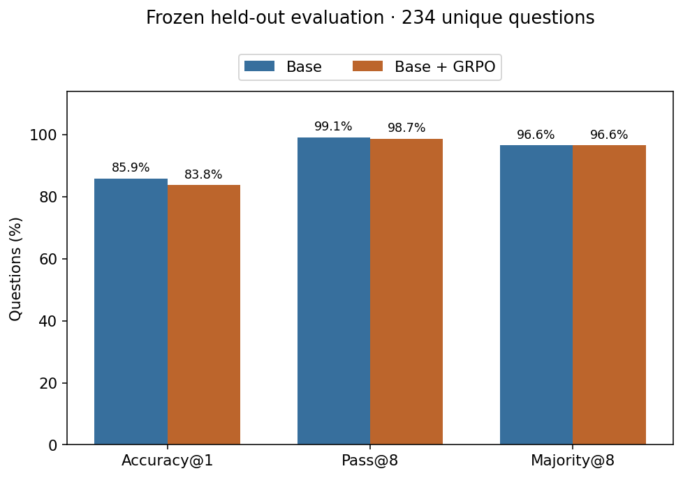
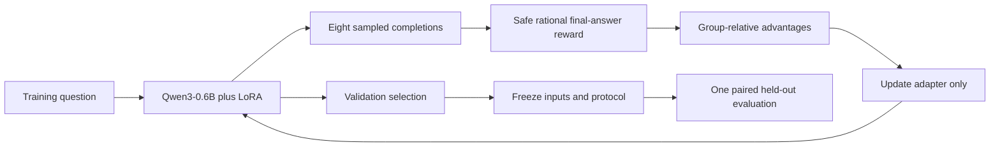
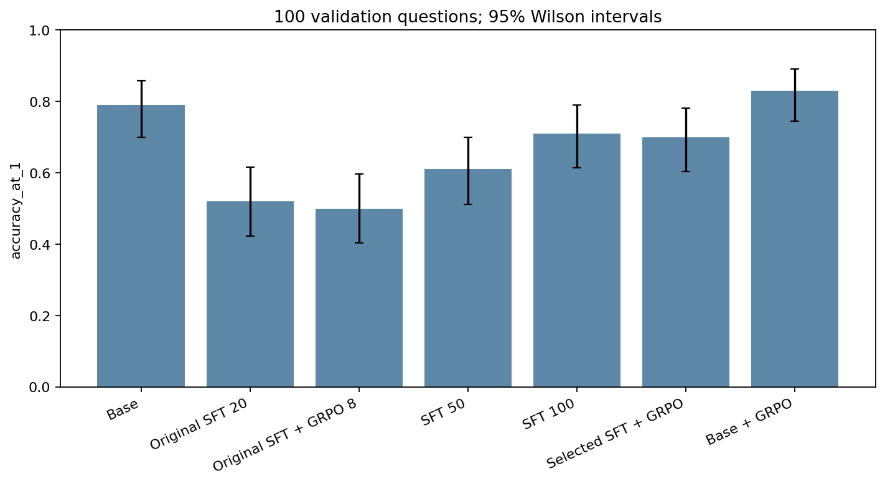
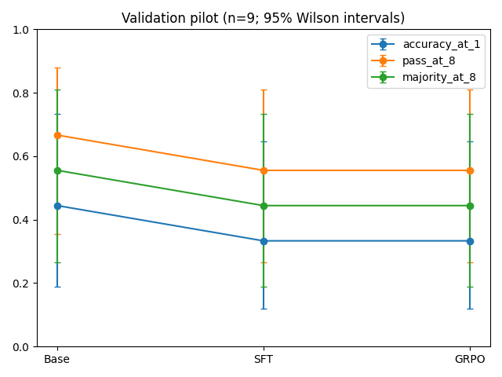
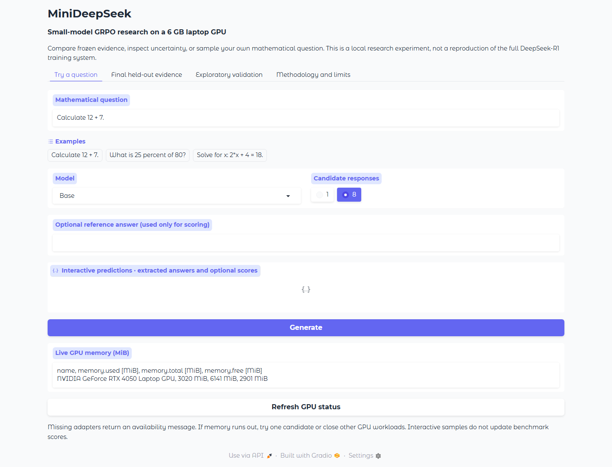

# MiniDeepSeek

[](https://github.com/Shahidali78/minideepseek/actions/workflows/ci.yml)

Can verifiable rewards improve a small model's mathematical accuracy? MiniDeepSeek compares Qwen3-0.6B, supervised LoRA adapters and eight-response GRPO on a native Windows laptop with a 6 GB RTX 4050. Seven exploratory validation configurations led to two frozen finalists: the unmodified model and GRPO trained directly from it.

**This is a small-model GRPO research experiment, not a reproduction of the full DeepSeek-R1 training system.** The motivation is practical: measure what short local reinforcement learning changes, including failed hypotheses, sampling uncertainty and hardware costs.

[Final research report](docs/final-research-report.md) · [Architecture](docs/architecture.md) · [Reproducibility](docs/reproducibility.md) · [Limitations](docs/limitations.md) · [Portfolio case study](docs/portfolio-case-study.md) · [Verification](docs/verification.md)

## Frozen held-out comparison

<!-- FINAL_RESULTS_START -->
| Frozen finalist | Accuracy@1 | Wilson 95% CI | Pass@8 | Majority@8 |
|---|---:|---:|---:|---:|
| Base | 85.90% | 80.86%–89.78% | 99.15% | 96.58% |
| Base + GRPO | 83.76% | 78.50%–87.93% | 98.72% | 96.58% |

GRPO minus Base: **-2.14 percentage points**; 2 improved, 7 worsened, 225 unchanged first-answer outcomes. Two-sided exact paired McNemar p=0.179688. Paired empirical bootstrap 95% interval: [-4.70, +0.00] percentage points.

The exact paired test does not provide conventional 5% significance evidence of improved first-answer accuracy. This does not establish equivalence.

Both models used 234 unique held-out questions and eight paired-seed samples per question. The original 240-row file was preserved; six repeated questions were excluded before outcomes. See [the final report](docs/final-research-report.md) and [aggregate evidence](docs/evidence/phase3-final-20261030/summary.json).


<!-- FINAL_RESULTS_END -->

## How GRPO works here



The stack is Python, PyTorch BF16/SDPA, Hugging Face Transformers, TRL 0.23.1, PEFT LoRA, Matplotlib, pytest and Gradio. It uses no learned reward model and no paid cloud GPU. Public source excludes weights, adapters, raw datasets and private evaluation completions; [aggregate evidence](docs/evidence/) supplies counts, uncertainty and hashes. Exact private checkpoints cannot be downloaded from this repository.

<!-- PHASE2_RESULTS_START -->
## Phase 2 validation study

Seven configurations were evaluated on the same 100 validation questions with eight samples each and a 256-token completion cap. These are exploratory validation/tuning measurements, separate from the frozen final comparison above.

| Model | Accuracy@1 | Pass@8 | Majority@8 |
|---|---:|---:|---:|
| Base | 79.0% | 96.0% | 91.0% |
| Original SFT 20 | 52.0% | 63.0% | 53.0% |
| Original SFT + GRPO 8 | 50.0% | 64.0% | 52.0% |
| SFT 50 | 61.0% | 72.0% | 63.0% |
| SFT 100 | 71.0% | 79.0% | 70.0% |
| Selected SFT + GRPO | 70.0% | 79.0% | 69.0% |
| Base + GRPO | 83.0% | 98.0% | 90.0% |

The selected SFT budget was 100 steps. The highest observed Accuracy@1 was 83.0% (Base + GRPO). Selection uses validation data, and small changes require the paired intervals before interpretation.

Base + GRPO corrected four first answers and regressed none; exact paired p=0.125. The observed +4-point gain is promising but not conclusive evidence of general improvement.

[Phase 2 research report](docs/phase2-experiment-report.md) contains confidence intervals, reward-variance analysis, actual configurations, runtime, memory, failure analysis and reproduction commands. [Diagnosis](docs/phase2-diagnosis.md), [reward analysis](docs/grpo-reward-analysis.md), and [portfolio summary](docs/phase2-portfolio.md) are saved separately from the historical report.



Recorded Phase 2 verification: 84 CPU tests passed; 10 measured plots verified; all 96 protected historical files unchanged.
<!-- PHASE2_RESULTS_END -->


## Historical nine-question pilot

Nine fixed validation questions, eight samples each; 20 SFT updates followed by eight GRPO updates. Both stages changed adapter parameters. No accuracy improvement was observed.

| Model | Accuracy@1 | Pass@8 | Majority@8 | Seconds/response |
|---|---:|---:|---:|---:|
| Base | 44.4% | 66.7% | 55.6% | 8.117 |
| SFT | 33.3% | 55.6% | 44.4% | 1.059 |
| SFT + GRPO | 33.3% | 55.6% | 44.4% | 1.052 |

These were small validation pilots with wide confidence intervals. SFT improved format compliance from 58.3% to 98.6%, while responses became much shorter. The baseline hit the 96-token cap on 30/72 samples. The reserved test was unused at this historical stage. The original 50-test suite passed then; see [current verification](docs/verification.md) for expanded checks. Native Windows BF16 inference, SFT and eight-candidate GRPO ran on the detected 6 GB GPU.



The [full report](docs/experiment-report.md) contains intervals, training evidence, hardware, versions, charts and limitations. [Portfolio wording](docs/portfolio.md) provides the repository description and three resume bullets.

To reproduce the recorded protocol in new directories:

```powershell
.\.venv\Scripts\python scripts/create_data.py --output data/reproduction
.\.venv\Scripts\python scripts/run_pipeline.py --data data/reproduction --examples 9 --sft-steps 20 --grpo-steps 8 --output outputs/reproduction
```

## Local environment

Detected on 29 October 2026: Windows 11, AMD Ryzen 7 7435HS, 34,169,589,760 bytes RAM (31.8 GiB), RTX 4050 Laptop GPU with 6,141 MiB VRAM, NVIDIA driver 591.91. `nvidia-smi` reports driver CUDA compatibility 13.1; the PyTorch wheel uses its own CUDA runtime. About 4.8 GiB VRAM was available during initial inspection. Python is 3.12.8.

Start in PowerShell from this directory:

```powershell
python -m venv .venv
.\.venv\Scripts\python -m pip install torch==2.8.0 --index-url https://download.pytorch.org/whl/cu128
.\.venv\Scripts\python -m pip install -r requirements-training.txt
.\.venv\Scripts\python -m pip install -e . --no-deps
.\.venv\Scripts\python -m pip check
.\.venv\Scripts\python scripts/preflight.py --apis
.\.venv\Scripts\python -m pytest -q
```

Exact direct dependencies are pinned in `requirements.txt`; install the CUDA wheel first. `requirements-training.txt` excludes torch so it won't replace the CUDA build. The full tested dependency closure is saved in [requirements-lock.txt](requirements-lock.txt). Install it after the CUDA wheel to reproduce transitive versions. The selected stack is a reproducibility target, not a claim to use the latest releases. API signatures are captured by preflight.

Native Windows uses PyTorch SDPA, standard Transformers generation, and the torch AdamW optimizer. No vLLM, FlashAttention, bitsandbytes, or custom CUDA extensions are required. If a native dependency fails, WSL2 Ubuntu is an alternative: install WSL with your approval, open Ubuntu, create the environment on its Linux filesystem, install the same pins and CUDA wheel, then run preflight. The host NVIDIA driver supplies GPU support; don't install a second display driver inside WSL. No WSL installation or driver changes are automated here.

## Data and protocol

The original train/validation/test files contain 1,200/150/240 rows, with 1,063/148/234 unique questions. No question crosses splits. Training deduplicates in memory, and evaluation uses unique questions in first-occurrence order. Original files are never rewritten. Dataset hashes accompany every run.

```powershell
# Separate dataset; refuses to overwrite any existing directory
.\.venv\Scripts\python scripts/create_data.py --output data/expanded-v1
# Optional: GSM8K official training partition, with deterministic validation holdout
.\.venv\Scripts\python scripts/create_data.py --gsm8k --output data/gsm8k-v1
```

Expanded synthetic data adds exact division, percentages, fractions, word problems and algebra to arithmetic. All answers are computed using integer/rational operations. GSM8K uses the published reference after `####`; official GSM8K test examples aren't downloaded for training. Its references aren't independently mathematically audited. The reserved original test is copied into new dataset directories without changing its question/answer content.

You can inspect data for structural contamination before training, but never use test performance to choose settings. The recorded final study is complete. Its comprehensive freeze includes the unmodified model and selected GRPO adapter; see the one-run safeguards in [reproducibility](docs/reproducibility.md). Inspect the runner without generating more held-out answers:

```powershell
.\.venv\Scripts\python scripts/phase3_final.py --help
```

The gate verifies config, dataset, and adapter hashes. It cannot enforce human research conduct after a test score has been revealed. The original reserved test is arithmetic only, so broader skills need a separately reserved benchmark.

## Model and training

Qwen3-0.6B is a dense causal decoder language model. Its downloaded config specifies 28 layers, hidden size 1,024, 16 attention heads, eight KV heads, head dimension 128 and vocabulary size 151,936. PEFT trains rank-8 LoRA matrices on its query and value projections; the pretrained weights remain frozen. The prompt requests a single `\boxed{number}`. Evaluation and training use Qwen's chat template with thinking disabled in the pilot, controlling response length on this GPU. This protocol measures final-answer accuracy, not the validity of a reasoning trace.

SFT uses verified final answers with completion-only loss. It doesn't fabricate chain-of-thought targets. Settings in `configs/pilot.json` include sequence length 256, completion cap 96, microbatch 1, accumulation 8, SFT learning rate 1e-4, GRPO learning rate 5e-6, temperature 0.6, top-p 0.95 and top-k disabled. BF16 is selected only when CUDA reports support; otherwise CUDA FP16 is used. Gradient checkpointing reduces activation memory. CLI flags choose steps, data directory, output, and SFT initialization.

```powershell
# Run a small controlled validation pilot before longer experiments
.\.venv\Scripts\python scripts/evaluate.py --max-examples 8 --output outputs/base-val.json
.\.venv\Scripts\python scripts/train_sft.py --steps 2 --output outputs/sft-pilot
.\.venv\Scripts\python scripts/evaluate.py --adapter outputs/sft-pilot --max-examples 8 --output outputs/sft-val.json
.\.venv\Scripts\python scripts/train_grpo.py --sft-adapter outputs/sft-pilot --steps 2 --output outputs/grpo-pilot
.\.venv\Scripts\python scripts/evaluate.py --adapter outputs/grpo-pilot --max-examples 8 --output outputs/grpo-val.json
```

GRPO draws eight sampled candidates per prompt. These are independent samples, not a guarantee of eight distinct strings. A strict rational checker assigns 1 for a correct final answer and 0 otherwise. It supports integers, signed decimals, fractions and correctly grouped thousands. It rejects ambiguous multiple answers, invalid denominators, units and executable expressions. `<answer>number</answer>` is also accepted. No model-generated code runs.

For a group of eight rewards, the normalized advantage is

$$A_i = \frac{r_i - \bar r}{s_r + \epsilon}.$$

TRL computes group normalization and policy optimization, with clipped probability ratios and optional KL penalty. Identical-reward groups have zero advantage and provide no correctness gradient. We log their frequency; if all groups are identical, optimizer calls can occur without changing parameters, and the run must not be reported as successful learning. Pilot beta is zero, so KL is disabled and isn't reported as measured. With positive beta, PEFT's reference-policy behavior must be reviewed: disabling the active adapter references the underlying base rather than automatically preserving the initial SFT policy.

The trainer uses a generation batch of eight and gradient accumulation eight, keeping the requirement explicit. If this exceeds memory, shorten sequences in a separately named configuration or use a compatible execution environment. Never relabel fewer candidates as the eight-generation experiment.

## Evaluation and evidence

Accuracy@1 uses the first sample. Pass@8 asks whether any of eight samples is correct. Majority@8 compares the most frequent normalized valid answer to the reference; ties fail, and malformed answers abstain. Format compliance is reported separately. The historical pilot sampled serially. Phase 2 uses a fixed eight-sample generation batch, recorded in the evaluation protocol; amortized throughput and batch latency are saved separately. Fixed question order, seeds and decoding settings are shared across stages. Identical seeds don't imply identical generated continuations.

Each JSON contains model revision, configuration, dataset hash, hardware, raw responses, extracted answers, token counts and per-question timings. CSV contains per-question scores. Timing covers generation and decoding, excludes model loading, and synchronizes CUDA. Peak VRAM is PyTorch allocated memory, not the entire WDDM device footprint. Training additionally samples `nvidia-smi` at log events. Accuracy@1 has a Wilson 95% interval; small pilots have wide uncertainty. A larger paired validation study is needed before claiming a gain.

```powershell
.\.venv\Scripts\python scripts/plot_results.py --runs outputs/sft-pilot/experiment.json outputs/grpo-pilot/experiment.json --evaluations outputs/base-val.json outputs/sft-val.json outputs/grpo-val.json
.\.venv\Scripts\python scripts/dashboard.py
```

Plots show measured loss, reward, reward standard deviation, zero-variance groups, completion length, VRAM, duration and stage accuracy when those measurements exist. The comparison validator rejects mismatched datasets, revisions, settings or question sets. The Gradio dashboard runs on localhost, loads one model at a time, shows extracted answers and reads measured evaluation files. Missing adapters and results are shown as unavailable.

## Tests and checkpoint handling

CPU tests run without a model download. They cover numeric equivalence, malformed outputs, reward exploits, contamination, deduplication, record formats, config checks, generator determinism and frozen-protocol changes. Preflight instantiates the installed TRL configs. GPU training checks that parameters really changed, validates saved tensors and writes logs; adapter evaluation reloads it for inference.

Checkpoints, private datasets, local environments and model weights are ignored by Git. Preserve the original data locally. For a public repo, generated datasets can be recreated with the generator; describe provenance before distributing third-party data. Nothing is published automatically.

## Scope and next experiments

This is a small local experiment. Format learning, shared templates, short completion caps, answer-only SFT and a tiny validation pilot limit conclusions about reasoning. Current math equivalence covers rational numbers only. Improvements should be confirmed using larger held-out samples, paired uncertainty estimates, multiple training seeds and independently audited word problems. Expand beyond constant-difference sequences and reserve broader benchmarks before claiming general mathematical reasoning.

## Local dashboard

```powershell
.\.venv\Scripts\python scripts/dashboard.py
```

The interface separates interactive predictions from exploratory validation and frozen final evidence. It offers all seven configurations where their local adapters are available, one/eight candidates, extracted answers, optional reference scoring, live GPU memory, measured charts and methodology. Missing adapters and memory errors return a message. It binds to 127.0.0.1 with public sharing disabled.



## Current reproduction and CI

Use [the reproducibility guide](docs/reproducibility.md) for the pinned model download, environment, deterministic dataset hashes and one-run final-test safeguards. To reconstruct the selected training procedure in a fresh, separately named experiment:

```powershell
.\.venv\Scripts\python scripts/train_sft.py --config configs/phase2-eval.json --data data/expanded-v2 --steps 100 --output outputs/my-sft100
.\.venv\Scripts\python scripts/train_grpo.py --config configs/phase2-eval.json --data data/expanded-v2 --from-base --steps 16 --output outputs/my-grpo-base16
.\.venv\Scripts\python -m pytest -q
.\.venv\Scripts\python -m compileall -q src scripts tests
.\.venv\Scripts\python scripts/dashboard.py --smoke
```

These are procedural reconstruction commands, not requests to retrain the frozen finalists. Original historical adapters are not distributed. The Phase 2 batch runner expects those local artifacts; see the guide before using it in a fresh checkout. Never rerun the used final test to select a better score.

GitHub Actions in [.github/workflows/ci.yml](.github/workflows/ci.yml) runs syntax checks and lightweight offline CPU tests with read-only repository permissions. It doesn't download models, launch training or evaluate the reserved test. Local checks and remote CI status are reported separately in [verification](docs/verification.md).

## Future work

Use multiple training/sampling seeds and a new, independently held-out benchmark with disjoint task templates. Audit licensed multi-step tasks and test completion-cap sensitivity on validation before freezing another study. The existing final set is evaluation evidence, not a tuning target. Review [limitations](docs/limitations.md), [contribution rules](CONTRIBUTING.md), the [MIT source license](LICENSE) and separate [model/data notices](docs/third-party-notices.md).

References: [Qwen3 model](https://huggingface.co/Qwen/Qwen3-0.6B), [pinned SFT API](https://huggingface.co/docs/trl/v0.23.1/sft_trainer), [pinned GRPO API](https://huggingface.co/docs/trl/v0.23.1/grpo_trainer), [PyTorch installation](https://pytorch.org/get-started/locally/).
