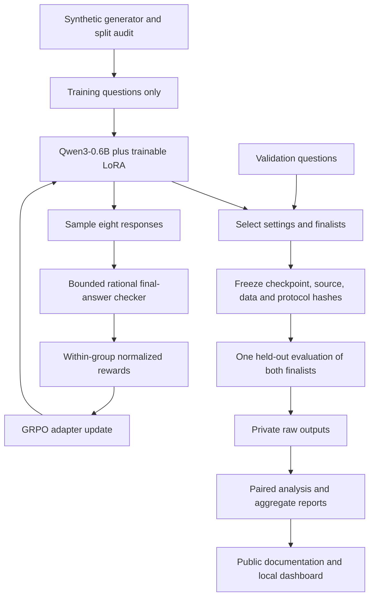

# How the experiment fits together

MiniDeepSeek keeps data checks, scoring and statistical analysis independent of GPU training. Qwen3-0.6B supplies the language model; PEFT trains small LoRA adapters. TRL performs SFT and eight-response GRPO. Gradio loads an adapter for local demonstrations and displays saved aggregate measurements separately.

`core.py` contains prompts, a bounded rational-expression parser, binary rewards and per-question metrics. Gold values are supplied to scoring, never included in generated prompts. `data.py` validates schemas, recomputes supported synthetic references and checks split separation. `runtime.py` handles pinned configuration, BF16 model loading, hardware provenance and atomic JSON saves.

`training.py` runs the actual optimizers and verifies that adapters changed. Reward diagnostics record group variance and advantages without retaining response bodies by default. `evaluate.py` records eight candidates, seeds, EOS-aware truncation, timing and peak allocated memory. Its test path requires a frozen protocol.

`phase3_final.py` freezes input hashes, keeps a source snapshot and uses an exclusive start marker. A second execution against the same run directory fails rather than replacing evidence. `phase3_report.py` rechecks saved metrics and exports aggregates; it never generates answers or changes model weights. Statistical comparisons retain question pairing. Dashboard generation is an interactive demonstration, not a new benchmark.

The local `outputs/` tree contains all checkpoints, training logs and raw evaluation completions. It is ignored by Git. Public `docs/evidence/` contains selected aggregate measurements and manifests, with no raw completions or individual test questions. GPU workloads run sequentially; CI runs lightweight CPU tests only.
