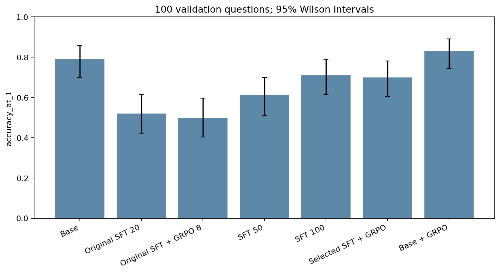
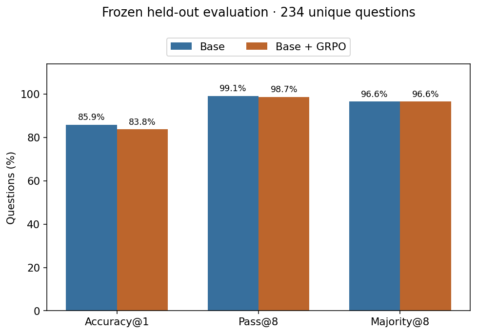
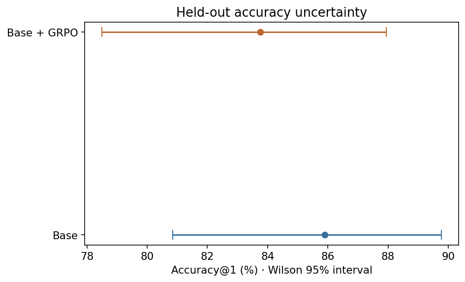
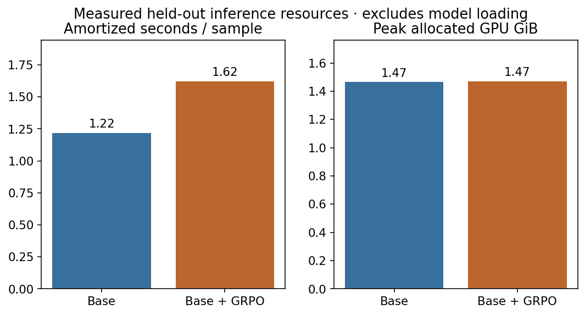
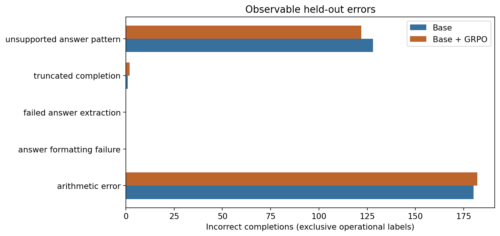

# MiniDeepSeek final research report

## Abstract

MiniDeepSeek tests whether binary verifiable rewards can improve a 0.6B language model on synthetic arithmetic using a 6 GB laptop GPU. Seven exploratory validation conditions led to two frozen finalists: unmodified Qwen3-0.6B and its 16-update LoRA GRPO adapter. They were evaluated once on 234 unique held-out questions, eight samples per question. GRPO minus Base: **-2.14 percentage points**; 2 improved, 7 worsened, 225 unchanged first-answer outcomes. Two-sided exact paired McNemar p=0.179688. Paired empirical bootstrap 95% interval: [-4.70, +0.00] percentage points. The exact paired test does not provide conventional 5% significance evidence of improved first-answer accuracy. This does not establish equivalence.

This is a small-model GRPO research experiment, not a reproduction of the full DeepSeek-R1 training system.

## Research question and background

Can short, local GRPO training improve final-answer accuracy without requiring a learned reward model? GRPO samples a group of responses and centers their verifiable rewards to form relative advantages. Groups with identical rewards supply no within-group correctness signal. This implementation uses TRL 0.23.1, group reward scaling and loss_type=grpo, with beta=0 (no reference-policy KL penalty). The binary reward gives 1 for a safely parsed, mathematically equivalent final value and 0 otherwise. Neither verbosity nor plausible intermediate text earns reward. See the [versioned TRL documentation](https://huggingface.co/docs/trl/v0.23.1/grpo_trainer).

## Model, hardware and checkpoint identities

The unmodified checkpoint is `Qwen/Qwen3-0.6B`, revision `c1899de289a04d12100db370d81485cdf75e47ca`. Base means the requested unmodified release; its [model card](https://huggingface.co/Qwen/Qwen3-0.6B) describes post-training, so it is not a pretraining-only checkpoint. The selected adapter is `outputs/phase2/grpo-base16`, SHA256 `0cc8bca96ecdde6589e0c61149b0197edab14e34c881c6d72127a0439280e7a9`. No finalist was retrained or tuned during Phase 3.

Native Windows 11, AMD Ryzen 7 7435HS, approximately 31.8 GiB system RAM and NVIDIA RTX 4050 Laptop GPU (6141 MiB). Python 3.12.8; torch 2.8.0+cu128; transformers 4.56.2; TRL 0.23.1; PEFT 0.17.1. BF16 and SDPA were used. The [frozen manifest](../../evidence/phase3-final-20261030/manifest.json) records every environment version and checkpoint/file hash. The private original manifest SHA256 is `8d63264c0de13cc187616e9826ab05bada97c94fe6e4d50502c90fcf825df18c`; the public copy replaces absolute local paths with repository-relative paths. The [frozen source snapshot](../../evidence/phase3-final-20261030/source-snapshot.md) preserves the executed evaluation code separately from publication changes.

## Dataset, splits and separation

The existing synthetic-v2 data has 1200 unique training questions and 150 unique validation questions; exploratory evaluation used a fixed 100-question validation prefix. The reserved file contains 240 rows, with six duplicate questions: **all 234 first-occurrence unique questions** were selected before model outcomes. Duplicate rows were not additional independent observations. Nothing was added to or removed from the original dataset files.

The held-out set is addition, subtraction and multiplication with operands in the original 71–110 range. It is narrower than the nine-category training/validation generator. Exact and NFKC/case/whitespace-normalized overlap audits found no held-out question matches against any saved training or validation version. Repeated templates and operand structures still limit independence and distributional generalization. The test was previously read for schema/reference-integrity and split-exclusion checks; no saved test generations, reward training, model selection or tuning were found before this freeze. This is an audit of available artifacts, not proof about all possible historical access.

The generator reproduces expanded-v2 train, validation and test files byte-for-byte in the recorded local reconstruction check. The project-generated synthetic arithmetic is distinct from externally licensed benchmarks; no GSM8K data was used for these reported results. Raw datasets are excluded from publication.

## Training methodology and reward

Historical SFT budgets were 20, 50 and 100 actual optimizer updates using verified final-answer-only targets. SFT100 was selected by predeclared validation Accuracy@1, then Majority@8, then Pass@8, then smaller budget. Original SFT+GRPO used eight updates; new selected-SFT and unmodified-model GRPO conditions each used 16 actual updates after separate four-update signal pilots. LoRA rank8, alpha16, q_proj/v_proj targets, dropout0; AdamW; microbatch1, accumulation8; SFT learning rate1e-4, GRPO5e-6. The two GRPO initializations have equal update/sample budgets, not equal compute because response lengths differ.

The bounded rational-expression parser accepts final boxed or answer-tag values, fractions, decimals, signs, percentages and a small arithmetic AST. It rejects arbitrary names, calls, powers and malformed/multiple answer fields. There is no eval/exec path. Gold answers enter scoring, never prompts. Accepting a mathematically equivalent expression does not itself prove the model computed its value.

The experiment was frozen on 30 October 2026; both GPU evaluations completed that day (recorded completion: 16:30:09 UTC). Documentation and publication verification resumed on 7 November 2026. No final-test generations were repeated during that continuation.

## Frozen experimental design

Both finalists used identical non-thinking chat prompts, temperature0.6, top_p0.95, top_k0, 256 completion tokens and batches of eight. Question i receives seed42+i independently for each model. Paired seeds reduce a source of variation but do not make token sequences or random trajectories identical. No outcome-dependent cap changes or reruns were performed.

Accuracy@1 is correctness of the first stochastic candidate, not greedy accuracy. Pass@8 is the observed presence of at least one correct candidate among eight. Majority@8 scores the unique modal parsed value; ties/no parsed values fail and invalid samples abstain. Parser success and numeric correctness are separate: an extracted value may be wrong. Completion truncation is measured using EOS-aware token IDs, independently of correctness.

The equal finite completion cap can still censor longer responses differently. Truncation rates below quantify the effect; an equal cap does not establish absence of length bias. Full outputs remain in ignored `outputs/phase3-final-20261030`. A durable exclusive start marker prevents accidental reruns of this final experiment.

## Exploratory validation evidence

| Model | Accuracy@1 | Pass@8 | Majority@8 |
|---|---:|---:|---:|
| Base | 79% | 96% | 91% |
| Original SFT20 | 52% | 63% | 53% |
| Original SFT + GRPO8 | 50% | 64% | 52% |
| SFT50 | 61% | 72% | 63% |
| SFT100 | 71% | 79% | 70% |
| SFT100 + GRPO16 | 70% | 79% | 69% |
| Base + GRPO16 | 83% | 98% | 90% |

These 5600 completions supported model selection; they are not independent confirmation. The +4-point first-answer gain for Base+GRPO was four corrections with no regressions, exact paired p=0.125. SFT100 improved 19 points over SFT20 but stayed below the unmodified model. Answer-only adaptation changed observed output length and format compliance. A narrow training distribution, limited updates and the supervised objective are plausible explanations for underperformance, but no ablation establishes a causal explanation. Base-initialized GRPO was selected for its observed validation accuracy and stronger mixed-reward support, not on final-test outcomes. The [Phase 2 report](../../phase2-experiment-report.md) preserves all seven conditions and their uncertainty.

## Final held-out results

| Frozen finalist | Accuracy@1 | Wilson 95% CI | Pass@8 | Majority@8 |
|---|---:|---:|---:|---:|
| Base | 85.90% | 80.86%–89.78% | 99.15% | 96.58% |
| Base + GRPO | 83.76% | 78.50%–87.93% | 98.72% | 96.58% |

## Paired statistical analysis

GRPO minus Base: **-2.14 percentage points**; 2 improved, 7 worsened, 225 unchanged first-answer outcomes. Two-sided exact paired McNemar p=0.179688. Paired empirical bootstrap 95% interval: [-4.70, +0.00] percentage points.

The exact paired test does not provide conventional 5% significance evidence of improved first-answer accuracy. This does not establish equivalence. The p-value is not the probability that GRPO is better. The primary inferential comparison is Accuracy@1; other metrics are descriptive, without multiplicity-adjusted claims. Pass@8 difference: -0.43 points. Majority@8 difference: +0.00 points.

Wilson intervals describe each accuracy proportion. The paired bootstrap resamples whole questions, retaining model pairing, with 5000 draws and seed42. Sparse discordance can make an empirical bootstrap optimistic or degenerate; it cannot invent unobserved failures. Exact McNemar conditions on discordant pairs and uses a two-sided binomial test ([reference](https://www.statsmodels.org/stable/generated/statsmodels.stats.contingency_tables.mcnemar.html)). Shared synthetic templates weaken the assumption that questions are independent draws. A single group of eight samples per question does not estimate variability over training or sampling seeds. Failing to reject is not evidence of equivalence; even a small p-value here would not establish general mathematical reasoning.

## Reward diagnostics

During the selected Base+GRPO16 training, 9/16 groups had mixed correctness; 7/16 (43.75%) had zero reward variance. Mean reward was 0.7265625. In SFT100+GRPO16, only 4/16 were mixed and 12/16 (75%) zero variance; mean reward 0.625. Each group had eight genuine sampled outputs. Centered advantages can yield near-zero on-policy scalar loss despite nonzero gradients. Saved adapters changed and finite weights were verified. These are training observations, not held-out accuracy evidence. [Reward analysis](../../grpo-reward-analysis.md) includes measured variance plots.

## GPU efficiency

| Finalist | Extraction success | Truncation | Mean tokens | Seconds / batch | Seconds / sample | Peak allocated GiB |
|---|---:|---:|---:|---:|---:|---:|
| Base | 93.11% | 0.05% | 57.31 | 9.742 | 1.218 | 1.465 |
| Base + GRPO | 93.38% | 0.11% | 57.59 | 12.964 | 1.620 | 1.469 |

Sequential laptop runs may differ in clocks, thermal state and background load; the timing difference is not a controlled speedup/slowdown claim. Latency synchronizes CUDA and includes decoding but excludes model loading; seconds/sample is batch time divided by eight, not interactive latency. GPU memory is torch peak allocated, not total process usage, cache reservation or total device memory. Base+GRPO16 training used about 1.678 GiB peak allocated and 366.45 seconds including save on this laptop. Historical SFT100 inference memory covers only its resumed final 11 questions; that partial peak is not compared as a complete measurement.

## Observable failure analysis

| Operational label | Base (all samples) | Base + GRPO (all samples) |
|---|---:|---:|
| correct | 1563 | 1566 |
| arithmetic error | 180 | 182 |
| multi step reasoning error | 0 | 0 |
| incorrect operation selection | 0 | 0 |
| answer formatting failure | 0 | 0 |
| failed answer extraction | 0 | 0 |
| truncated completion | 1 | 2 |
| unsupported answer pattern | 128 | 122 |
| unclassified numeric error | 0 | 0 |

Labels are mutually exclusive for incorrect completions: truncation first, then extraction/format patterns, then parsed numeric mismatch. Arithmetic error means an incorrect extracted final value on an arithmetic question; it does not identify an unseen internal step. A plain number without the required field is labeled formatting failure. A malformed/unsupported boxed or answer-tag field is an unsupported answer pattern; other missing fields are extraction failures. Independent truncation and parsing metrics can overlap, unlike this table. Operation-selection and multi-step-reasoning categories remain zero because final-value mismatches alone do not establish those causes. This test contains only single-operation arithmetic, so it cannot meaningfully test multi-step reasoning.

Representative failures are reviewed privately in `failure-review.json`; [the aggregate evidence](../../evidence/phase3-final-20261030/summary.json) publishes counts, not raw test completions. No explanation of hidden reasoning is inferred from prose.

Manual review of four first-answer failures per finalist found repeated boxed final fields, visibly incorrect numeric arithmetic, and an algebraic identity applied to incompatible operands. One unmodified-model response repeated the correct value in two boxes and failed the predeclared exactly-one-field rule; other repeated boxes also accompanied wrong values. We retained that strict rule for both models. Printed steps occasionally contradicted the final value or used an invalid decomposition, but these observations describe text, not hidden cognition.

On first samples, Base had 20 parsed numeric errors and 13 unsupported-field failures. GRPO had 23 parsed numeric errors, 14 unsupported-field failures and one truncated failure. Across all eight samples, the operational counts were 180 versus 182 arithmetic errors, 128 versus 122 unsupported-field failures and one versus two truncated failures. These are descriptive counts; the selected sample does not establish a systematic change in error mechanisms. The slight all-sample extraction improvement did not improve first-answer accuracy.

## Reproducibility and verification

See [reproducibility](../../reproducibility.md) for Windows setup, controlled commands, checkpoints and one-run safeguards. Frozen source snapshots, original input hashes, exact generation commands, synchronized timings and complete raw responses remain local. The public aggregate JSON records hashes of those raw outputs, allowing authorized artifact holders to verify them. Checkpoints are deliberately not redistributed, so the public repository supports procedural reconstruction, not downloading this exact private adapter. A later training reconstruction may differ numerically across kernels/drivers.

Actual check outcomes and publication status are recorded in [verification](../../verification.md). The final eval itself loaded both checkpoints and performed real GPU inference. No retraining occurred after test exposure.

## Limitations and conclusion

Read the final-test evidence separately from the exploratory validation table. The final set is larger than a 12-question pilot, but still consists of only 234 template-based arithmetic questions. Its restricted operation/operand range, question dependence, single training seed, single stochastic sample group, fixed completion cap and semantic answer checker limit the claim. The name MiniDeepSeek does not imply reproduction of DeepSeek-R1's data, architecture, scale or training recipe.

The exact paired test does not provide conventional 5% significance evidence of improved first-answer accuracy. This does not establish equivalence. The defensible deliverable is a measured local SFT/GRPO pipeline with a frozen, auditable held-out comparison. Future studies should preregister multiple training and evaluation seeds, include independently sourced/licensed multi-step tasks, use disjoint template families and test cap sensitivity on a new validation set. The used final set must not become a tuning set for another claimed confirmation.
