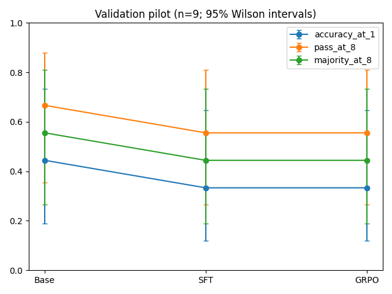
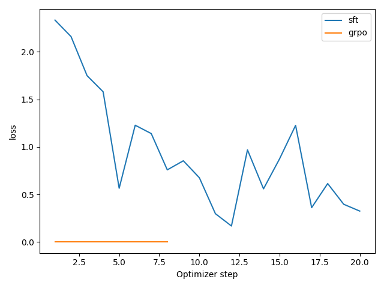
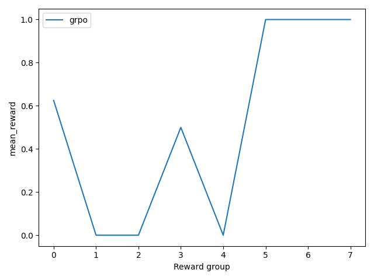
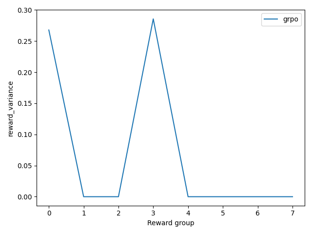
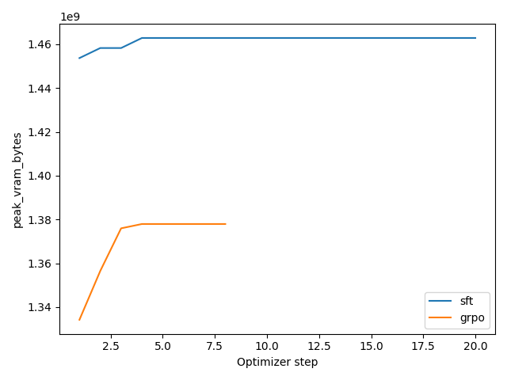
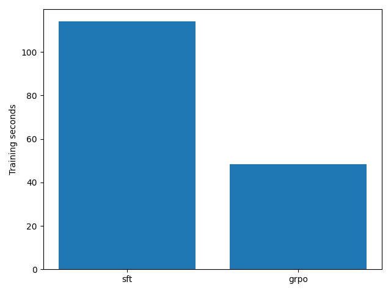

# Experiment report

Measured validation pilot: 9 questions, eight samples per question. These results do not demonstrate improved mathematical reasoning.

| Model | Accuracy@1 | Pass@8 | Majority@8 | Seconds/response | Peak allocated GiB |
|---|---:|---:|---:|---:|---:|
| Base | 44.4% | 66.7% | 55.6% | 8.117 | 1.144 |
| SFT (20 steps) | 33.3% | 55.6% | 44.4% | 1.059 | 1.138 |
| SFT + GRPO (8 steps) | 33.3% | 55.6% | 44.4% | 1.052 | 1.138 |

All stages use the same validation IDs, model revision, seed and decoding settings. Majority ties fail; malformed answers abstain. Peak allocation is measured by PyTorch and excludes the full CUDA/WDDM device footprint. Latency excludes model loading.

| Model | Accuracy@1 Wilson 95% CI | Format compliance | Mean generated tokens | At completion cap |
|---|---:|---:|---:|---:|
| Base | 18.9% to 73.3% | 58.3% | 73.74 | 41.7% |
| SFT | 12.1% to 64.6% | 98.6% | 8.06 | 0.0% |
| GRPO | 12.1% to 64.6% | 98.6% | 8.06 | 0.0% |

The sample is too small for a reliable improvement claim. SFT substantially changed formatting and response length; those effects confound interpretation as reasoning ability. The baseline cap truncates many responses. Paired bootstrap differences are saved in `outputs/comparison.json`.

## Training evidence

| Stage | Optimizer steps | Parameters changed | Final logged loss | Seconds including save | Peak allocated GiB |
|---|---:|---|---:|---:|---:|
| SFT | 20 | True | 0.3247 | 113.98 | 1.362 |
| GRPO | 8 | True | 0 | 48.30 | 1.283 |

GRPO recorded 8 eight-response groups (64 samples). Mean reward was 0.515625; 6/8 groups had zero reward variance. Samples can repeat: distinct responses per group ranged from 1 to 8. Eight draws were retained in every group.

The GRPO scalar loss is near zero because centered advantages can cancel at an on-policy ratio of one. Nonzero gradient norms in mixed-reward groups and changed adapter tensors establish real optimization. KL was disabled (beta=0), so no KL measurement is claimed. Reward values from different training questions should not be read as a learning curve for held-out accuracy.

Before these runs, a two-step SFT memory pilot changed weights. A two-step GRPO memory pilot produced only all-zero-reward groups and did not change weights. Its saved adapter still loaded for inference. All pilot artifacts are preserved separately.

## Hardware and environment

Windows 11; AMD Ryzen 7 7435HS; 34,169,589,760 bytes RAM (31.8 GiB); RTX 4050 Laptop GPU with 6,141 MiB VRAM; driver 591.91. Driver CUDA compatibility is 13.1; the tested PyTorch runtime is CUDA 12.8. Native Windows inference, BF16 LoRA SFT and eight-response GRPO all executed successfully with these short sequences. This does not establish support for arbitrary long sequences or larger models.

Model revision: `c1899de289a04d12100db370d81485cdf75e47ca`.

Direct installed versions:

- torch 2.8.0+cu128
- transformers 4.56.2
- trl 0.23.1
- peft 0.17.1
- accelerate 1.10.1
- datasets 4.1.1
- safetensors 0.6.2
- evaluate 0.4.6
- numpy 2.2.6
- pandas 2.3.2
- matplotlib 3.10.6
- pytest 8.4.2
- tensorboard 2.20.0
- gradio 5.49.1
- psutil 7.1.0

The full dependency lock is [requirements-lock.txt](../requirements-lock.txt). `pip check` passed. Installed SFTTrainer/GRPOTrainer signatures and config construction are recorded in `outputs/preflight.json`. The CUDA wheel was checked against the official SHA256 before installation.

## Dataset and reproduction

Dataset directory: `data/expanded-v2`. Statistics and SHA256 hashes:

```json
{
  "train": {
    "rows": 1200,
    "unique_questions": 1200,
    "duplicates": 0,
    "sha256": "07cd8c0bb3b1847444d23a62ee98bc85db2511332507727c256240cdd1bdc6df"
  },
  "val": {
    "rows": 150,
    "unique_questions": 150,
    "duplicates": 0,
    "sha256": "b90d42ebe363dc1d00ae1b44c911d2e873582bf72e6013935e6153248adb4d19"
  },
  "test": {
    "rows": 240,
    "unique_questions": 234,
    "duplicates": 6,
    "sha256": "e0bc1bf69d465de5e8d3a560d60238cf9cb0631d5af564f3204b61f832c4dff4"
  }
}
```

The original reserved test file is unchanged and has not been evaluated. The expanded test copy preserves its questions and answers. No training data comes from validation or test. SFT used 160 examples over 20 accumulated updates, rather than a full epoch. The broad generator checks exact question overlap; shared templates and semantically similar arithmetic remain limitations.

Pilot settings are in [configs/pilot.json](../configs/pilot.json): rank 8 query/value LoRA, microbatch 1, accumulation 8, SFT LR 1e-4, GRPO LR 5e-6, BF16, SFT cap 256, GRPO prompt cap 160, completion cap 96, eight generations, seed 42, temperature 0.6, top-p 0.95, top-k disabled, thinking disabled.

Run from the project root after installing the pinned CUDA environment:

```powershell
.\.venv\Scripts\python scripts/create_data.py --output data/reproduction
.\.venv\Scripts\python scripts/run_pipeline.py --data data/reproduction --examples 9 --sft-steps 20 --grpo-steps 8 --output outputs/reproduction
.\.venv\Scripts\python scripts/dashboard.py --sft outputs/sft-run1 --grpo outputs/grpo-run1
```

Use a new output directory for every run. Exact reruns can still vary across drivers, kernels and hardware; seeds do not guarantee bitwise equality. [README](../README.md) covers environment setup, memory pilots, protocol freezing and the reserved final test. A frozen manifest for the selected adapters is stored in `outputs/frozen-protocol.json`.

## Verification and limits

The final test log is `outputs/tests.log`. The CPU suite runs without downloading model weights; its tiny random-model test performs an optimizer update and adapter round-trip entirely offline. GPU evidence includes baseline generation, SFT and GRPO weight changes, and inference from saved adapters. The Gradio interface passed a build smoke check. GitHub Actions is prepared, but no remote CI or publication has been run.

GSM8K support is optional and has not been exercised in this run. Its published answers are imported without inventing reasoning traces. These short synthetic experiments, one seed, rational-only rewards and nine validation questions cannot establish broad generalization. A larger held-out validation study, longer completion budgets, independently verified reasoning targets and multiple training seeds remain future work.

## Measured charts













Additional charts, CSVs and raw response JSON files are in `outputs/`. [Portfolio wording](portfolio.md) includes the suggested repository description and three resume bullets.

Independent artifact checks confirmed 112 changed adapter tensors between SFT and GRPO (maximum absolute difference 1.5452504e-05), and 3 changed validation responses. All 64 stored training rewards recomputed correctly. Original dataset hashes and the frozen protocol were verified.
