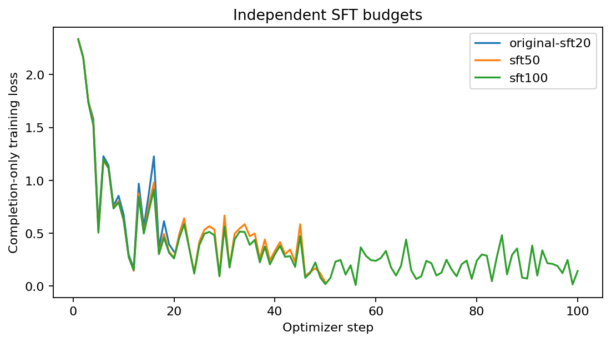
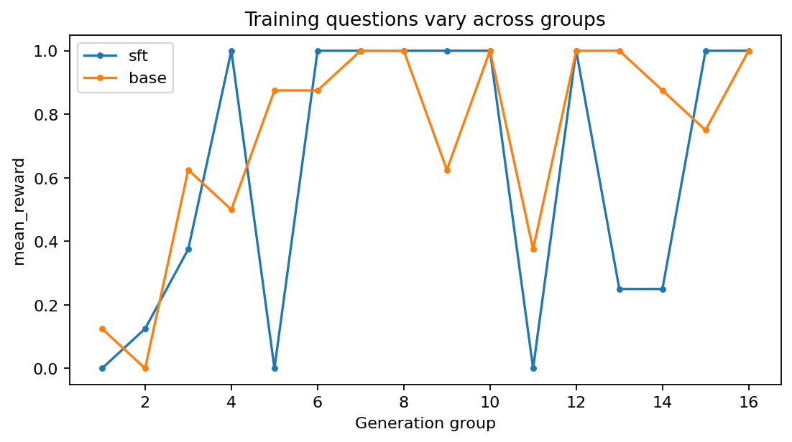
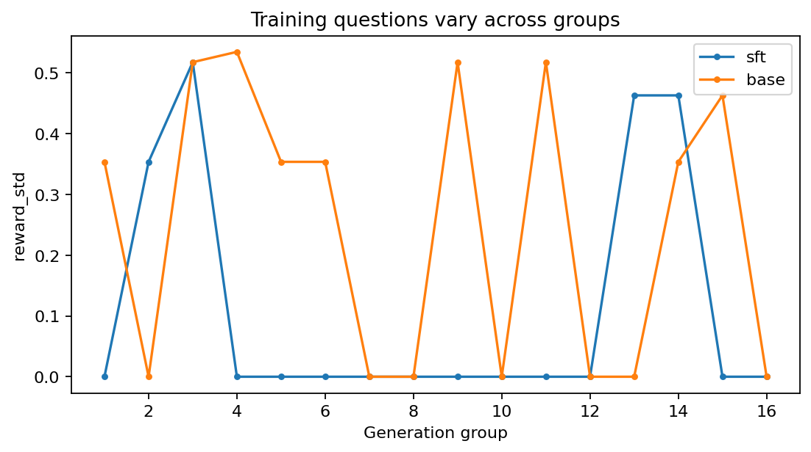
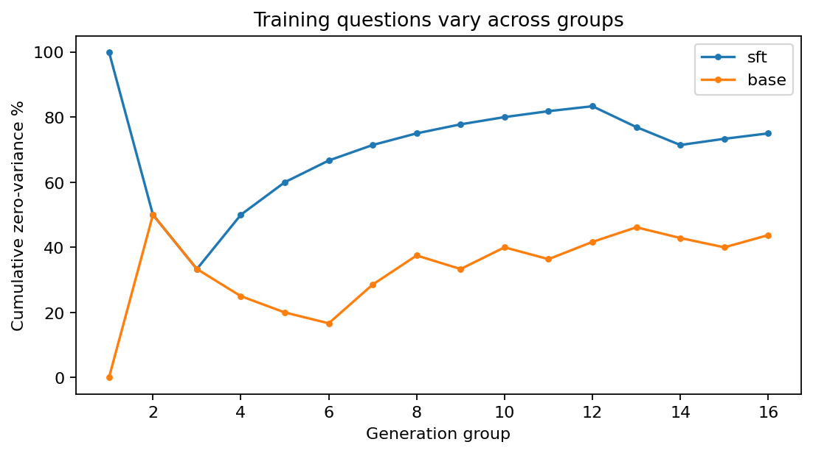
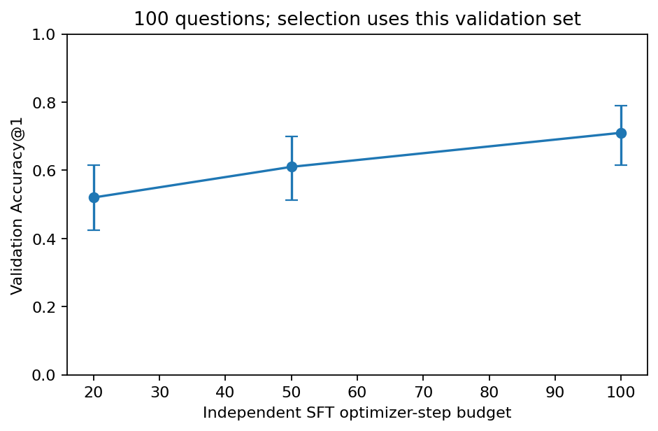
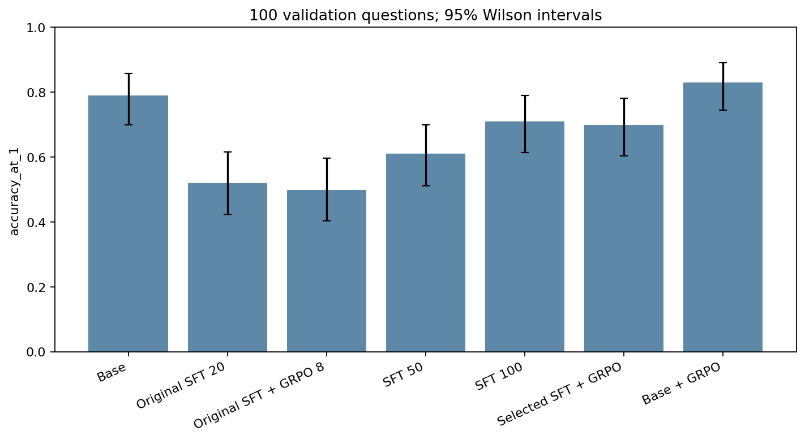
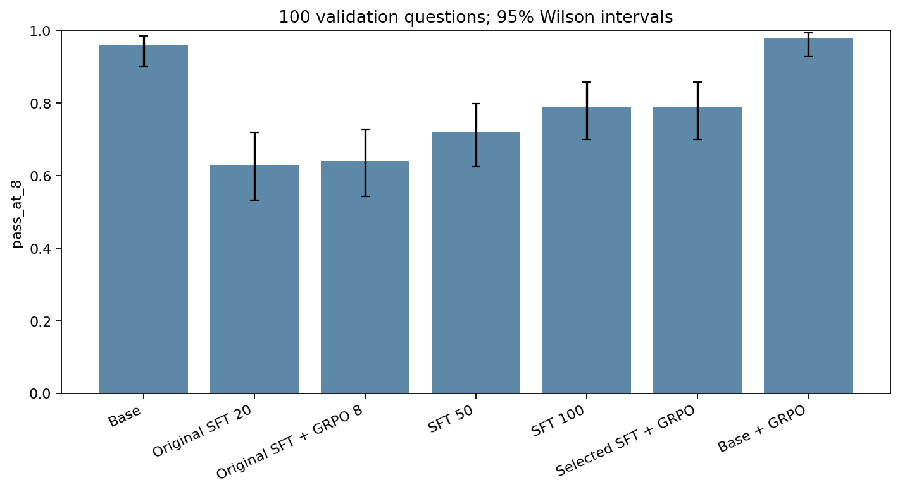
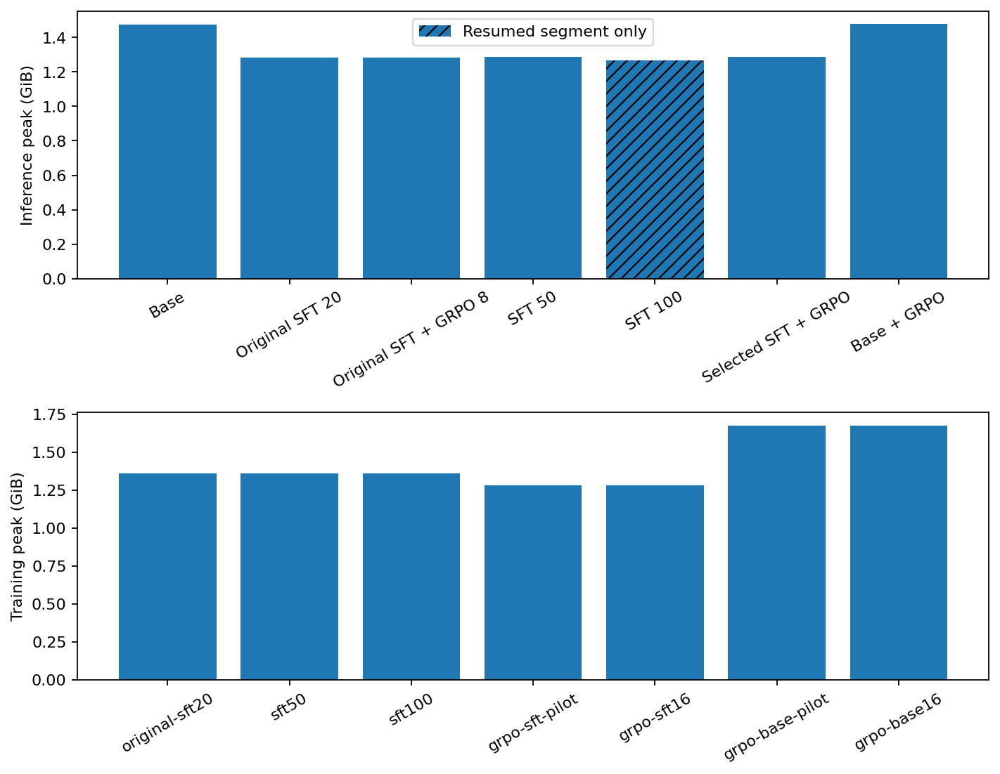
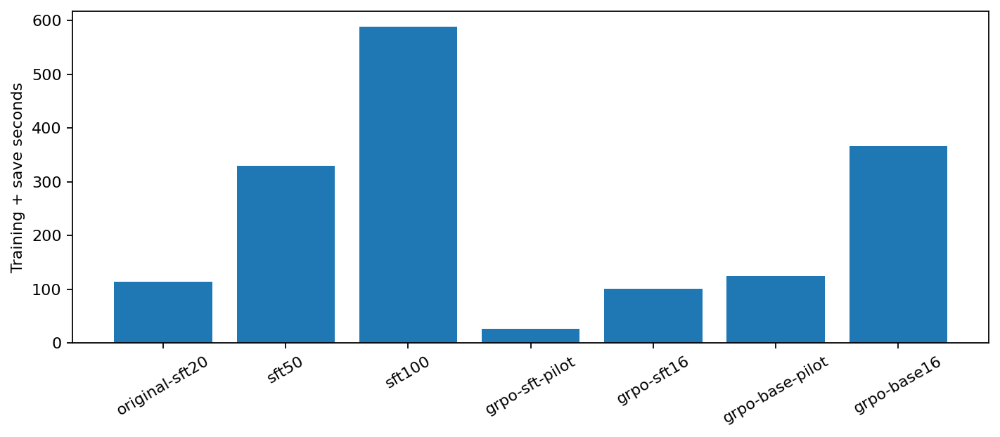

# Phase 2 experiment report

## Research objective

Test whether a larger SFT budget and more informative eight-response GRPO groups improve final-answer accuracy of the requested Qwen3-0.6B checkpoint on existing validation data. No held-out final test was evaluated. A correct answer does not establish a correct reasoning trace.

## Historical context and diagnosis

The original nine-question Base/SFT/GRPO Accuracy@1 scores were 44.4%, 33.3% and 33.3%; Pass@8 was 66.7%, 55.6% and 55.6%. The base hit its 96-token cap on 30/72 outputs. SFT learned much shorter, more consistently formatted responses. The old GRPO run had 75% zero-variance groups. Re-scoring old raw outputs with the new parser recovered no extra correct responses. See [diagnosis](phase2-diagnosis.md) and [reward analysis](grpo-reward-analysis.md).

These historical scores must not be compared directly with Phase 2 as a training gain: question count, completion budget, parser capability, sampling batch and CPU-thread setting changed. Phase 2 model comparisons below share one evaluation protocol.

## Environment and data

The original project environment was retained. RTX 4050 Laptop GPU, 6,141 MiB VRAM; AMD Ryzen 7 7435HS; 31.8 GiB RAM; native Windows; Python 3.12.8; PyTorch 2.8.0+cu128, BF16. Full dependency versions remain in [requirements-lock.txt](../requirements-lock.txt). Native PyTorch generation is used without vLLM, FlashAttention extensions or cloud resources.

Data: 1,200 unique synthetic training examples and 150 unique validation examples across nine categories. The fixed first 100 validation questions were used, with no exact or commuted-arithmetic overlap with training. Existing files were not rewritten. A hash manifest protects 96 historical datasets, reports, charts and adapter files. Shared templates and unknown pretraining exposure remain limitations. Equivalent numeric expressions are accepted, so exact-division prompts can sometimes be answered by repeating an input fraction. This is semantic final-value correctness, not proof that the model performed the computation.

"Base" means the unmodified requested model, which already includes post-training according to its [model card](https://huggingface.co/Qwen/Qwen3-0.6B), rather than a pretraining-only release. Non-thinking mode remains fixed; this is not a long-thinking R1 replication.

## Reward and evaluation

Rewards are 1 for a verified final answer and 0 otherwise, with no length or formatting bonus. The bounded rational-expression parser supports signed numbers, fractions, decimals, percentages and arithmetic equivalence. It uses a strict AST whitelist, never model code execution. Multiple final-answer fields are rejected. References are a separate reward column and are not included in generation prompts.

Eight samples per question, seed 42 plus question index, temperature 0.6, top-p 0.95, top-k disabled, completion cap 256, generation batch eight and one CPU thread. Prompt chat templates and model revision are identical across model comparisons. EOS-aware truncation is separate from parsing failure and parsed incorrect answers. Saved token counts exclude padding after EOS. Majority@8 uses the unique most frequent normalized valid answer; ties fail and invalid answers abstain. It is a plurality vote, not a requirement for five correct answers out of eight. The quoted per-sample time is batch time divided by eight, a throughput measure; batch/question latency is also saved and is more relevant to interactive waiting.

A three-question smoke test finished with no truncated outputs and peak PyTorch allocation below 1.4 GiB. All full comparisons below contain 100 questions and 800 sampled completions per model. Wilson intervals describe per-question metrics; paired bootstrap differences use matched questions, 5,000 resamples and a fixed seed. These intervals do not account for every dependence induced by shared templates.

## Validation measurements

| Model | Accuracy@1 [95% CI] | Pass@8 | Majority@8 | Invalid | Truncated | Amortized s/sample | Peak allocated GiB |
|---|---:|---:|---:|---:|---:|---:|---:|
| Base | 79.0% [70.0%, 85.8%] | 96.0% | 91.0% | 9.1% | 1.8% | 1.827 | 1.475 |
| Original SFT 20 | 52.0% [42.3%, 61.5%] | 63.0% | 53.0% | 2.5% | 0.0% | 0.199 | 1.284 |
| Original SFT + GRPO 8 | 50.0% [40.4%, 59.6%] | 64.0% | 52.0% | 2.5% | 0.0% | 0.209 | 1.284 |
| SFT 50 | 61.0% [51.2%, 70.0%] | 72.0% | 63.0% | 2.2% | 0.0% | 0.202 | 1.287 |
| SFT 100 | 71.0% [61.5%, 79.0%] | 79.0% | 70.0% | 0.8% | 0.0% | 0.155 | 1.268* |
| Selected SFT + GRPO | 70.0% [60.4%, 78.1%] | 79.0% | 69.0% | 0.8% | 0.0% | 0.164 | 1.286 |
| Base + GRPO | 83.0% [74.5%, 89.1%] | 98.0% | 90.0% | 7.9% | 1.2% | 1.868 | 1.479 |

Memory note: an asterisk marks SFT100 inference memory measured only in its resumed final segment; the earlier peak was unavailable.

Selected SFT: `outputs\phase2\sft100` (100 steps). Selection rule was declared before full results: Accuracy@1, then Majority@8, Pass@8, then the smaller training budget. Selection and reporting use the same validation set, so this is a tuning result, not an unbiased final-test estimate.

## Extraction, length and latency

| Model | Extracted answers | Parsed incorrect samples | Mean generated tokens | Mean eight-sample batch seconds |
|---|---:|---:|---:|---:|
| Base | 90.88% | 8.12% | 88.91 | 14.616 |
| Original SFT 20 | 97.50% | 44.62% | 8.48 | 1.592 |
| Original SFT + GRPO 8 | 97.50% | 45.38% | 8.45 | 1.669 |
| SFT 50 | 97.75% | 35.75% | 8.65 | 1.617 |
| SFT 100 | 99.25% | 30.00% | 8.42 | 1.244 |
| Selected SFT + GRPO | 99.25% | 30.25% | 8.42 | 1.311 |
| Base + GRPO | 92.12% | 8.00% | 88.57 | 14.945 |

Batch latency and amortized sample time are distinct; neither is a controlled speed comparison with the original serial nine-question run.

## Training budgets and evidence

The original 20-step adapter was preserved. Fresh 50- and 100-step SFT runs used the same verified answer-only labels, seed, rank-8 query/value LoRA, AdamW, microbatch 1, accumulation 8 and initial LR 1e-4. Completion-only masking was checked with an offline trainer fixture. Loss decreases alone do not establish reasoning improvement. Different step budgets imply different linear learning-rate schedules.

GRPO used four-step pilots from the selected SFT and from the unmodified model. A separate temperature-0.9 pilot was allowed if fewer than 25% of groups had mixed correctness; otherwise temperature remained 0.6. Sixteen-step final runs were allowed only when mixed groups supplied learning signal. The training completion cap was 256; LR was 5e-6; beta was zero. Initialization comparisons can also differ in the selected exploration setting, and are not a pure causal ablation if that fallback was used.

| Run | Optimizer steps | Parameters changed | Seconds incl. save | Peak allocated GiB | Mean event-sampled GPU utilization |
|---|---:|---|---:|---:|---:|
| original-sft20 | 20 | True | 114.0 | 1.362 | 27.9% |
| sft50 | 50 | True | 330.1 | 1.362 | 25.6% |
| sft100 | 100 | True | 588.0 | 1.362 | 28.3% |
| grpo-sft-pilot | 4 | True | 26.9 | 1.280 | 25.2% |
| grpo-sft16 | 16 | True | 100.9 | 1.283 | 29.2% |
| grpo-base-pilot | 4 | True | 124.5 | 1.678 | 22.4% |
| grpo-base16 | 16 | True | 366.5 | 1.678 | 28.3% |

GPU utilization is sampled at logging events, not continuously. PyTorch peak allocation excludes driver/display memory. Timing includes checkpoint saving and logging, excludes loading and preprocessing, and is not a controlled speed benchmark against the historical run.

## Reward variance and paired effects

sft: 16 groups; zero variance 75.0%; any correct 81.2%; mixed correctness 25.0%; mean correct responses 5.000/8. Adapter parameters changed: True.

base: 16 groups; zero variance 43.8%; any correct 93.8%; mixed correctness 56.2%; mean correct responses 5.812/8. Adapter parameters changed: True.

SFT 100 minus Base: -8.0 percentage points, paired bootstrap 95% interval [-17.0, +1.0]; corrected 8, regressed 16; exact paired McNemar p=0.1516.
Original SFT + GRPO 8 minus Original SFT 20: -2.0 percentage points, paired bootstrap 95% interval [-5.0, +0.0]; corrected 0, regressed 2; exact paired McNemar p=0.5.
SFT 50 minus Original SFT 20: +9.0 percentage points, paired bootstrap 95% interval [+0.0, +18.0]; corrected 16, regressed 7; exact paired McNemar p=0.09314.
SFT 100 minus Original SFT 20: +19.0 percentage points, paired bootstrap 95% interval [+9.0, +29.0]; corrected 24, regressed 5; exact paired McNemar p=0.0005461.
Selected SFT + GRPO minus SFT 100: -1.0 percentage points, paired bootstrap 95% interval [-3.0, +0.0]; corrected 0, regressed 1; exact paired McNemar p=1.
Base + GRPO minus Base: +4.0 percentage points, paired bootstrap 95% interval [+1.0, +8.0]; corrected 4, regressed 0; exact paired McNemar p=0.125.

Near-zero GRPO scalar loss can occur with centered advantages and nonzero gradients. Weight-change and gradient checks distinguish real optimization from zero-variance stalls. Training reward varies with the sampled question, so a rising reward curve alone is not evidence of validation improvement. KL was disabled and no measured KL curve is claimed.

## Verification and reproduction

Offline tests cover rational/percentage equivalence, malformed and speculative outputs, AST exploitation, group statistics, EOS truncation, question selection, dashboard scoring, completion-only masking, adapter round-trip and checkpoint resume. Ordinary CI only runs CPU tests; it does not train the full model. Targeted GPU evidence consists of the actual training and adapter inference runs. Test logs, dependency checks and integrity verification are stored under `outputs/phase2/`.

```powershell
.\.venv\Scripts\python scripts/evaluate.py --config configs/phase2-eval.json --data data/expanded-v2 --max-examples 100 --generation-batch-size 8 --output outputs/phase2/base-val-v2.json
.\.venv\Scripts\python scripts/phase2_experiments.py
.\.venv\Scripts\python scripts/phase2_report.py
.\.venv\Scripts\python scripts/dashboard.py
.\.venv\Scripts\python -m pytest -q
```

The commands reproduce the fixed local protocol. Complete artifacts are reused and never overwritten; use `scripts/phase2_experiments.py --output-root outputs/phase2-reproduction` and `scripts/phase2_report.py --root outputs/phase2-reproduction` for a fresh versioned run. The runner records every executed training/evaluation command in `outputs/phase2/commands.json`. Interrupted evaluations use `--resume` and verify protocol/dataset/adapter hashes. Trainer checkpoints can resume into a new output directory using `--resume-from`, with the original planned hyperparameters. Runtime limits are 30 minutes per evaluation and 20 minutes per training run.

## Scientific limits and next direction

This is one seed, one small already-post-trained model and a narrow synthetic dataset. Final-answer-only SFT may suppress useful reasoning, while a strict single-answer format can penalize otherwise correct calculations. A 256-token cap can still censor responses; measured truncation rates above quantify this. Validation selection introduces optimism, multiple comparisons add uncertainty, and there is no final-test result. Absence of a convincing gain is a valid outcome, not evidence that GRPO can never help.

A useful paper direction is a controlled study of format collapse, output censoring and reward-gradient starvation in small-model RL. Future experiments should independently vary answer-only versus verified explanatory targets, completion budget and mixed-reward group frequency, using multiple seeds and a separately reserved benchmark. Do not infer valid reasoning from a numerical reward alone.

## Measured plots




















Highest observed Accuracy@1 was 83.0%, attained by Base + GRPO. This is a validation observation with the confidence intervals and selection limitations stated above, not a final-test claim.

On the paired first samples, SFT100 corrected 24 numerically wrong SFT20 answers and 0 unparseable answers, while losing 5 previously correct answers. The net Accuracy@1 change is not explained merely by extracting more boxes; output lengths stayed similar. Internal reasoning quality remains unverified.

SFT100 evaluation resumed after 89 saved questions following an interruption. Its earlier peak-memory counter was unavailable: the recorded SFT100 inference peak covers only the final 11-question segment, not the full run. Other completed inference runs report their full recorded peak. Per-question seeds, responses and timings were preserved; no suspension-sized timing outlier was present in the saved records.

The Base + GRPO Accuracy@1 gain is four corrected questions and no regressions. Its bootstrap interval is positive, but only four outcomes differ and the two-sided exact paired McNemar test gives p=0.125. This does not provide conventional 5% significance evidence of a general improvement. The empirical bootstrap cannot introduce an unobserved regression, so small-discordance intervals need particular caution. Pass@8 rose from 96% to 98% while Majority@8 fell from 91% to 90%; the metrics do not show uniform dominance. Multiple seeds and independent held-out evaluation are needed. The exact test uses the binomial distribution conditional on discordant pairs, as described in the [statsmodels McNemar documentation](https://www.statsmodels.org/stable/generated/statsmodels.stats.contingency_tables.mcnemar.html).

Recorded final verification: 84 CPU tests passed; 5,600 measured completions re-scored across 7 models; 10 plots verified; all 96 protected historical files unchanged. Dependency consistency, compilation, static checks and the Gradio build smoke check passed. The reserved final test was not evaluated.
